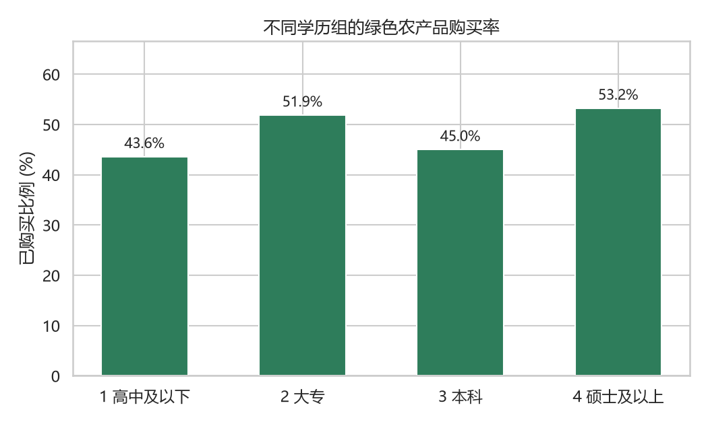
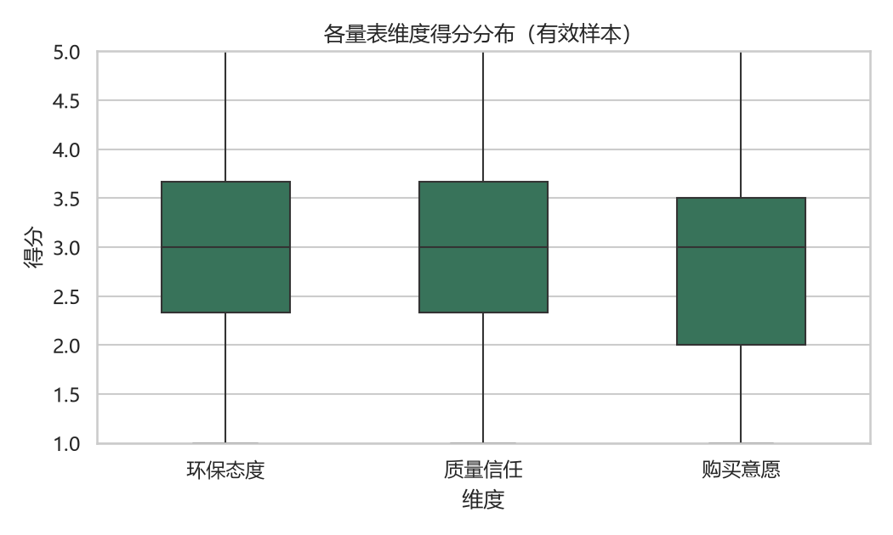
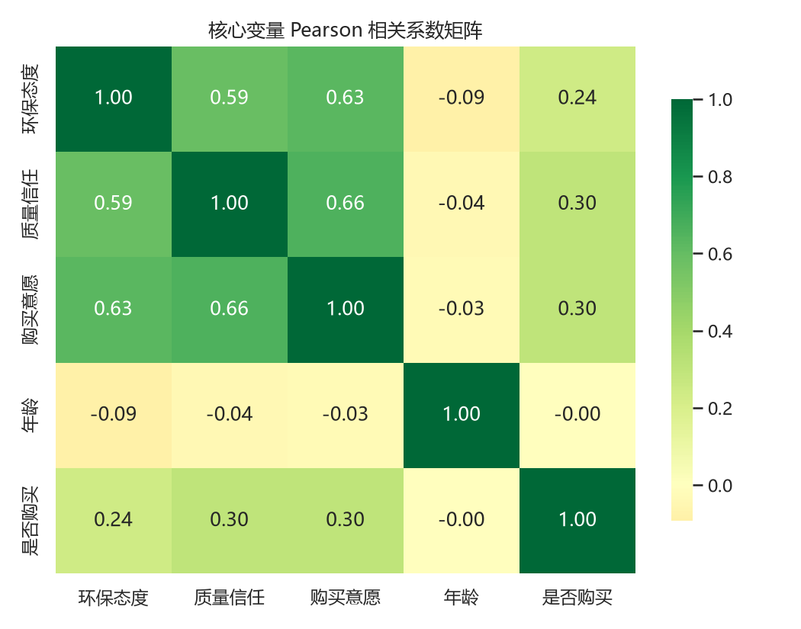

# 问卷数据分析管线 survey-analysis-pipeline

> 一份原始问卷进，一整套论文级分析结果出：**清洗 → 信度 → 描述统计 → 卡方检验 → Logistic 回归 → 开放题文本 → 中文图表 → Word 三线表报告，一条命令全自动。**

纯 Python 实现，无界面、无外部服务，换数据只改一个 `config.yaml`，**不改动任何代码**。

> ⚠️ 仓库内 `data/raw/sample_survey.csv` 为固定种子生成的**仿真数据（N=320，故意带缺失/越界/乱填）**，仅用于演示管线能否跑通，不代表真实调研结论。

---

## 这条管线解决什么

社科调查项目里最耗时间、最容易出错的一段：拿到原始问卷后手工点 SPSS、反复出表、把数字抄进论文。本项目把这段流程工程化：

| 环节 | 自动化内容 |
|---|---|
| 数据清洗 | 越界值识别、反向计分自动翻转、直线作答检测、注意力检验剔除、缺失插补 |
| 信度分析 | Cronbach's α、删除单题后 α、信度等级判定 |
| 描述统计 | 频数/百分比/有效百分比/累计百分比；均值、标准差、中位数、偏度 |
| 交叉分析 | 列联表、行百分比、卡方检验、Cramér's V、最小期望频数检查、自动结论文本 |
| 回归分析 | 二元 Logistic 回归：B / SE / Wald-z / p / OR / 95%CI / Pseudo R² |
| 文本分析 | 开放题 jieba 分词、停用词过滤、关键词频次 |
| 可视化 | 购买率柱状图、量表箱线图、相关系数热力图、关键词条形图 |
| 报告 | 自动生成 Word 报告，表格为论文规范**三线表**，图表自动嵌入 |

---

## 30 秒跑通

```bash
# 1. 安装依赖（建议虚拟环境，Python 3.10+）
pip install -r requirements.txt

# 2. 生成仿真问卷（可复现，真实项目中跳过此步，直接放入自己的数据）
python scripts/generate_sample_data.py

# 3. 一键运行完整分析
python main.py
```

运行结束后，所有结果在 `outputs/`：

```
outputs/
├── cleaned_data.csv          # 清洗后的分析底表
├── 01_信度分析.csv
├── 02_频数_Q*.csv
├── 03_描述统计.csv
├── 04_列联表.csv / 04_行百分比表.csv / 04_卡方检验.csv
├── 05_logistic回归.csv
├── 06_开放题关键词.csv
├── fig1_购买率_按学历.png
├── fig2_量表得分箱线图.png
├── fig3_相关性热力图.png
├── fig4_开放题关键词.png
└── 问卷数据分析报告.docx      # 三线表 + 图表的完整报告
```

测试：

```bash
pytest -q
```

---

## 换成自己的数据要做什么

1. 把真实问卷导出为 CSV，放到 `data/raw/`；
2. 改 `config.yaml`：反向题是哪几道、量表由哪几题组成、注意力检验题正确答案、要交叉哪两个变量、回归放哪些预测变量；
3. `python main.py`，完成。**不需要改 `src/` 下任何一行代码。**

---

## 项目结构

```
survey-analysis-pipeline/
├── config.yaml                 # 唯一需要随问卷修改的配置
├── main.py                     # 全流程编排入口（带日志与异常兜底）
├── requirements.txt
├── conftest.py
├── scripts/
│   └── generate_sample_data.py # 可复现的仿真脏数据生成器
├── src/
│   ├── io_utils.py             # 配置与数据加载
│   ├── cleaning.py             # 清洗与质量控制
│   ├── reliability.py          # Cronbach's α
│   ├── descriptives.py         # 频数与描述统计
│   ├── crosstab_analysis.py    # 列联表 + 卡方 + Cramér's V
│   ├── regression_mod.py       # Logistic 回归
│   ├── text_analysis.py        # 开放题分词
│   ├── charts.py               # 中文图表
│   └── report.py               # Word 三线表报告
├── tests/
│   └── test_pipeline.py        # 核心逻辑单元测试
├── data/raw/
└── outputs/                    # 已提交一份实跑结果
```

---

## 部分实跑输出







---

## 方法学说明

- 信度判定阈值：α≥0.8 良好，0.7–0.8 可接受，0.6–0.7 需说明，<0.6 需修订题项；
- 列联表自动报告最小期望频数，若 <5 会在结果中提示改用 Fisher 精确检验或合并类别；
- Logistic 回归中定序变量（如学历 1–4）按连续编码处理，属于社科研究常见做法；
- 缺失处理：量表题缺失比例 >20% 的整份问卷剔除，剩余缺失以题项中位数插补，规则与数量均写入报告可追溯。
